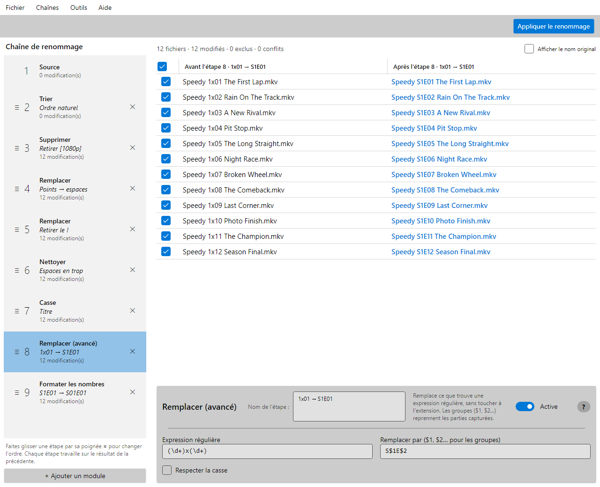

[English](README.md) | **Français**

# ChainRenamer

**Un logiciel libre et gratuit pour renommer des fichiers par lots sous Windows, où chaque règle est une étape que l'on voit.**

Renommez des centaines de fichiers d'un coup : épisodes de séries, photos, musique, scans, téléchargements. Vous construisez une **chaîne** d'étapes simples (trier, remplacer, changer la casse, numéroter…), chaque étape travaille sur le résultat de la précédente, et une grille montre chaque nom **avant et après chaque étape**. Rien n'est renommé avant le clic sur **Appliquer le renommage**, et un renommage peut être annulé.



*Douze épisodes téléchargés nommés `speedy.1x01.the.first.lap!.[1080p].mkv` deviennent `Speedy S01E01 The First Lap.mkv`. L'étape 8 est sélectionnée : la grille montre ce que fait cette étape seule.*

**[Télécharger la dernière version](../../releases)** : un seul `ChainRenamer.exe`, Windows 10 ou 11 (x64), rien à installer.

## Pourquoi ChainRenamer ?

Les renommeurs par lots classiques, comme Bulk Rename Utility, réunissent toutes leurs règles sur un seul écran : une douzaine de panneaux, appliqués dans un ordre fixe, chacun une seule fois, et l'on ne voit que le nom final. Quand le résultat est faux, il faut deviner quel panneau en est la cause, et certains enchaînements sont impossibles : on ne peut pas, par exemple, remplacer un texte *après* avoir changé la casse.

ChainRenamer remplace les panneaux par une chaîne de montage :

- **Chaque étape fait une seule chose simple.** La puissance vient de leur enchaînement, dans n'importe quel ordre, autant de fois que nécessaire.
- **On voit chaque étape.** Un clic sur une étape : la grille montre chaque nom avant et après elle. Une règle qui se trompe se repère tout de suite, et l'on corrige cette étape seulement.
- **Rien ne touche le disque avant d'appliquer.** Les problèmes (deux fichiers du même nom, caractères refusés par Windows, noms réservés comme `CON`, chemins trop longs) s'affichent en rouge à chaque étape.
- **Une règle peut épargner quelques fichiers.** Si une étape convient à tous les fichiers sauf trois, on décoche ces trois-là dans sa grille : cette étape les laisse tels quels, les autres s'appliquent toujours.
- **Une chaîne est une recette.** On l'enregistre, puis on la rejoue sur un autre dossier : le même nettoyage pour chaque nouvelle saison d'une série, chaque carte de photos, chaque album.

## Ce qu'il sait faire

**Choisir les fichiers**
- **Source** : un dossier local ou un partage réseau (`\\nas\video`), avec ou sans ses sous-dossiers ; on décoche les fichiers à laisser de côté.
- **Filtrer** : garder ou retirer des fichiers selon leur nom (texte, motif `*.mkv`, expression régulière), leur extension, leur taille, leur date de modification ou la longueur du nom.
- **Trier** : ordre naturel (`Episode 2` avant `Episode 10`), ou son propre ordre par glisser-déposer.

**Changer les noms**
- **Remplacer** : un texte par un autre ; toutes les occurrences, la première, la dernière, au début ou à la fin du nom.
- **Remplacer (avancé)** : expressions régulières avec groupes : `(\d+)x(\d+)` → `S$1E$2`.
- **Table de remplacement** : une liste de textes à remplacer, collée depuis un tableur ou chargée depuis un fichier texte, à réutiliser d'une chaîne à l'autre.
- **Supprimer** : les premiers ou derniers caractères, une plage de positions, ce qui précède ou suit un texte, chaque partie entre deux textes (`[1080p]`).
- **Insérer** : un texte au début, à la fin, à une position, avant ou après un texte.
- **Casse** : minuscules, MAJUSCULES, Titre ou Phrase, avec les petits mots des titres français ou anglais (`Le Seigneur des Anneaux`), des exceptions (`iPhone`, `TV`), les chiffres romains et les sigles.
- **Numérotation** : `001`, lettres ou chiffres romains, n'importe où dans le nom, en recommençant dans chaque dossier si on le souhaite.
- **Formater les nombres** : `Episode 5` → `Episode 05`, `S1E5` → `S01E05`.
- **Nettoyer** : espaces en trop, accents, chiffres, symboles, emojis.
- **Extension** : minuscules, majuscules, remplacer, ajouter, supprimer. Les autres étapes ne touchent jamais à l'extension.

**Renommer sans risque**
- Les échanges (A↔B), les cycles, les renumérotations et les changements de casse seule (`photo.jpg` → `Photo.jpg`) fonctionnent, y compris sur les partages réseau qui ignorent la casse.
- Chaque déplacement est écrit dans un journal : **Annuler ce renommage** remet tous les noms, même après une erreur au milieu.
- Juste avant de renommer, le disque est vérifié à nouveau : un fichier a pu apparaître depuis le chargement du dossier.

**Réutiliser son travail**
- **Bibliothèque** de chaînes enregistrées, **favoris** en dossiers comme dans un navigateur, import et export.
- **Ligne de commande** : `ChainRenamer.Cli` rejoue une chaîne enregistrée sur un dossier, dans des scripts ou des tâches planifiées.
- **Aide intégrée** (F1) : une page par module, avec des exemples calculés par le module lui-même.
- Interface en **français et en anglais**.

## Est-ce pour moi ?

ChainRenamer vous convient si vous renommez des fichiers par lots, sous Windows, et voulez comprendre ce que fait chaque règle avant que quoi que ce soit change sur le disque. Il est à l'aise avec les épisodes de séries et d'animes, les dossiers de photos, les albums de musique, et les dossiers sur un NAS.

Pas encore :
- **Métadonnées** : des noms construits à partir de la date EXIF des photos, des tags de musique (ID3) ou des propriétés vidéo sont prévus, pas disponibles.
- **Autres systèmes** : l'application est construite avec Avalonia, qui fonctionne aussi sous macOS et Linux, mais seule la version Windows est publiée et testée. Ses vérifications suivent les règles de nommage de Windows.
- **Scripts** : il n'y a pas de module de script ; les expressions régulières et la chaîne couvrent la plupart des besoins.

Le projet est jeune (version 0.x) : il fonctionne et il est testé, mais la liste des modules continue de s'allonger.

## À venir

- **Modules** : Modèle, Dates, Capturer (des parties du nom réutilisées comme variables).
- **Variables** dans tous les modules : `{dossier}`, `{date}`, puis l'EXIF des photos et les tags de musique.
- **Listes à déposer** : coller une liste de titres d'épisodes, la ligne N va au fichier N.
- **Segment de nom** : limiter une étape à une partie du nom, comme « après le dernier ` - ` ».

## Ligne de commande

```
ChainRenamer.Cli --chain <chaîne> [--subfolders] [--apply] [--library <dossier>] <dossier>
ChainRenamer.Cli --undo <journal>
```

`<chaîne>` est un fichier `.chain` ou le nom d'une chaîne de la bibliothèque (par défaut, celle choisie dans l'application). Sans `--apply`, la commande liste seulement ce qui serait renommé, avec les conflits. Avec, les fichiers sont renommés et la commande affiche le journal à donner à `--undo`. Code de sortie : 0 terminé, 1 conflits ou erreur de renommage, 2 arguments, chaîne ou dossier incorrects. Les messages de la commande sont en anglais.

```
ChainRenamer.Cli --chain Anime --subfolders "\\nas\video\Speedy"
```

La ligne de commande est dans son propre zip dans les [Releases](../../releases), `ChainRenamer.Cli-X.Y.Z-win-x64.zip`.

## Pour les développeurs

ChainRenamer est écrit en **C# / .NET 10**, avec [Avalonia UI](https://avaloniaui.net/) 12 (thème Fluent), [CommunityToolkit.Mvvm](https://github.com/CommunityToolkit/dotnet) et xUnit. Pour compiler, il faut le [SDK .NET 10](https://dotnet.microsoft.com/download) :

```
dotnet build
dotnet test
dotnet run --project src/ChainRenamer.App
```

```
src/ChainRenamer.Engine/          le moteur : pipeline, modules, chaînes, renommage (aucune dépendance graphique)
src/ChainRenamer.Cli/             ligne de commande
src/ChainRenamer.App/             application de bureau (Avalonia, MVVM)
tests/ChainRenamer.Engine.Tests/  tests du moteur
tests/ChainRenamer.App.Tests/     tests de l'application sans écran (aide, favoris, traductions)
docs/etude.md                     l'étude de conception
```

Le moteur est un pipeline de modules purs : chacun reçoit une liste de noms et en renvoie une nouvelle, et seule l'étape de renommage touche au disque. Le résultat de chaque étape est gardé en cache, et un changement ne recalcule qu'à partir de l'étape modifiée. Un nouveau module est une classe portant l'attribut `[Module("Nom")]` : le moteur ne change pas.

## Licence

[MIT](LICENSE) : libre, y compris pour un usage commercial.
