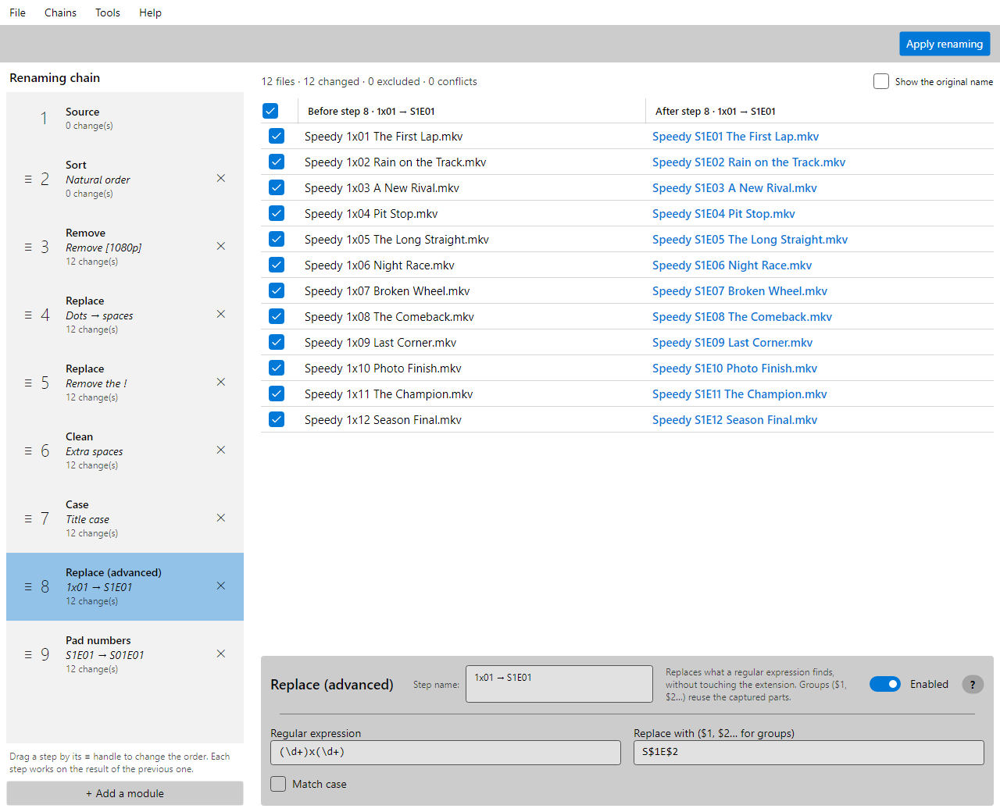

**English** | [Français](README.fr.md)

# ChainRenamer

**A free, open-source batch file renamer for Windows, where every rule is a step you can see.**

Rename hundreds of files at once: TV episodes, photos, music, scans, downloads. You build a **chain** of simple steps (sort, replace, change the case, number…), each step works on the result of the previous one, and a grid shows every name **before and after each step**. Nothing is renamed until you click **Apply renaming**, and a renaming can be undone.



*Twelve downloaded episodes named `speedy.1x01.the.first.lap!.[1080p].mkv` become `Speedy S01E01 The First Lap.mkv`. Step 8 is selected: the grid shows what that step alone does.*

**[Download the latest version](../../releases)**: a single `ChainRenamer.exe`, Windows 10 or 11 (x64), nothing to install.

## Why ChainRenamer?

Classic batch renamers, such as Bulk Rename Utility, put all their rules on one screen: a dozen panels, applied in a fixed order, each one once, and you only see the final name. When the result is wrong, you have to guess which panel caused it, and some sequences are impossible: you cannot, say, replace a text *after* changing the case.

ChainRenamer replaces the panels with an assembly line:

- **Each step does one simple thing.** The power comes from chaining them, in any order, as many times as needed.
- **You see every step.** Click a step: the grid shows each name before and after it. A rule that goes wrong is spotted at once, and you fix that step only.
- **Nothing touches the disk before you apply.** Problems (two files with the same name, characters Windows refuses, reserved names such as `CON`, paths too long) are shown in red at every step.
- **A rule can spare a few files.** If a step suits every file but three, uncheck those three in its grid: that step leaves them alone, the others still apply.
- **A chain is a recipe.** Save it, then replay it on another folder: the same clean-up for every new season of a series, every card of photos, every album.

## What it can do

**Choose the files**
- **Source**: a local folder or a network share (`\\nas\video`), with or without its subfolders; uncheck the files to leave out.
- **Filter**: keep or remove files by name (text, `*.mkv` pattern, regular expression), extension, size, modification date or name length.
- **Sort**: natural order (`Episode 2` before `Episode 10`), or your own order by drag and drop.

**Change the names**
- **Replace**: a text by another; all occurrences, the first, the last, at the start or at the end of the name.
- **Replace (advanced)**: regular expressions with groups: `(\d+)x(\d+)` → `S$1E$2`.
- **Replacement table**: a list of texts to replace, pasted from a spreadsheet or loaded from a text file, to reuse from one chain to another.
- **Remove**: the first or last characters, a range of positions, what comes before or after a text, every part between two texts (`[1080p]`).
- **Capture**: a regular expression with named groups turns parts of the name into variables, `{season}`, `{episode}`, reused by the following steps.
- **Template**: rebuild the whole name from text and variables: `{folder:2} - {folder} - {n:2}`.
- **Insert**: a text at the start, at the end, at a position, before or after a text.
- **Variables** in Template, Insert and Replace: `{folder}`, `{name}`, `{n}`, `{date}`, `{size}`, `{today}`…
- **Case**: lowercase, UPPERCASE, Title Case or Sentence case, with the small words of English or French titles (`The Lord of the Rings`), exceptions (`iPhone`, `TV`), Roman numerals and acronyms.
- **Numbering**: `001`, letters or Roman numerals, anywhere in the name, starting again in each folder if you want.
- **Pad numbers**: `Episode 5` → `Episode 05`, `S1E5` → `S01E05`.
- **Clean**: extra spaces, accents, digits, symbols, emojis.
- **Extension**: lowercase, uppercase, replace, add, remove. The other steps never touch the extension.

**Rename safely**
- Swaps (A↔B), cycles, renumbering and case-only changes (`photo.jpg` → `Photo.jpg`) work, including on network shares that ignore case.
- Every move is written to a journal: **Undo this renaming** puts every name back, even after an error in the middle.
- Just before renaming, the disk is checked again: a file may have appeared since the folder was loaded.

**Reuse your work**
- **Library** of saved chains, **favorites** in folders as in a browser, import and export.
- **Command line**: `ChainRenamer.Cli` replays a saved chain on a folder, for scripts and scheduled tasks.
- **Built-in help** (F1): a page per module, with examples computed by the module itself.
- Interface in **English and French**.

## Is it for me?

ChainRenamer suits you if you rename files by batches, on Windows, and want to understand what each rule does before anything changes on the disk. It is at ease with series and anime episodes, photo folders, music albums, and folders on a NAS.

Not there yet:
- **Metadata**: names built from photo EXIF dates, music tags (ID3) or video properties are planned, not available.
- **Other systems**: the app is built with Avalonia, which also runs on macOS and Linux, but only Windows is published and tested. Its checks follow the Windows naming rules.
- **Scripting**: there is no script module; regular expressions and the chain cover most needs.

The project is young (version 0.x): it works and is tested, but the list of modules keeps growing.

## Coming next

- **Dates**: find a date in the name and write it in another format.
- **Metadata variables**: photo EXIF dates, music tags.
- **Drop lists**: paste a list of episode titles, line N goes to file N.
- **Name segment**: limit a step to a part of the name, such as "after the last ` - `".

## Command line

```
ChainRenamer.Cli --chain <chain> [--subfolders] [--apply] [--library <folder>] <folder>
ChainRenamer.Cli --undo <journal>
```

`<chain>` is a `.chain` file or the name of a chain of the library (the one chosen in the app by default). Without `--apply`, the command only lists what would be renamed, with the conflicts. With it, the files are renamed and the command prints the journal to give to `--undo`. Exit code: 0 done, 1 conflicts or renaming error, 2 wrong arguments, chain or folder.

```
ChainRenamer.Cli --chain Anime --subfolders "\\nas\video\Speedy"
```

The command line comes in its own zip in the [Releases](../../releases), `ChainRenamer.Cli-X.Y.Z-win-x64.zip`.

## For developers

ChainRenamer is written in **C# / .NET 10**, with [Avalonia UI](https://avaloniaui.net/) 12 (Fluent theme), [CommunityToolkit.Mvvm](https://github.com/CommunityToolkit/dotnet) and xUnit. Building requires the [.NET 10 SDK](https://dotnet.microsoft.com/download):

```
dotnet build
dotnet test
dotnet run --project src/ChainRenamer.App
```

```
src/ChainRenamer.Engine/          the engine: pipeline, modules, chains, renaming (no UI dependency)
src/ChainRenamer.Cli/             command line
src/ChainRenamer.App/             desktop app (Avalonia, MVVM)
tests/ChainRenamer.Engine.Tests/  engine tests
tests/ChainRenamer.App.Tests/     app tests that need no screen (help, favorites, translations)
docs/etude.md                     the design study (in French)
```

The engine is a pipeline of pure modules: each one takes a list of names and returns a new one, and only the renaming step touches the disk. Each step's result is cached, and a change only recomputes from the step that changed. A new module is a class with a `[Module("Name")]` attribute: the engine does not change.

## License

[MIT](LICENSE): free, including for commercial use.
